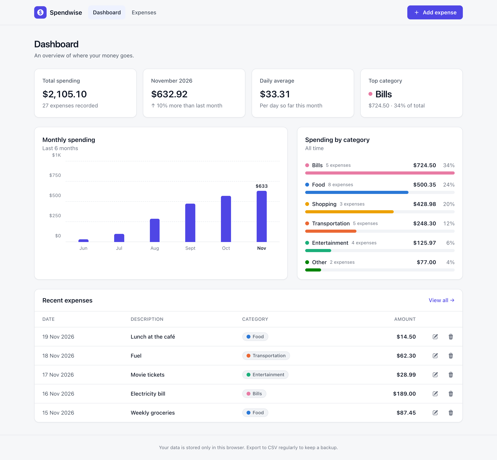
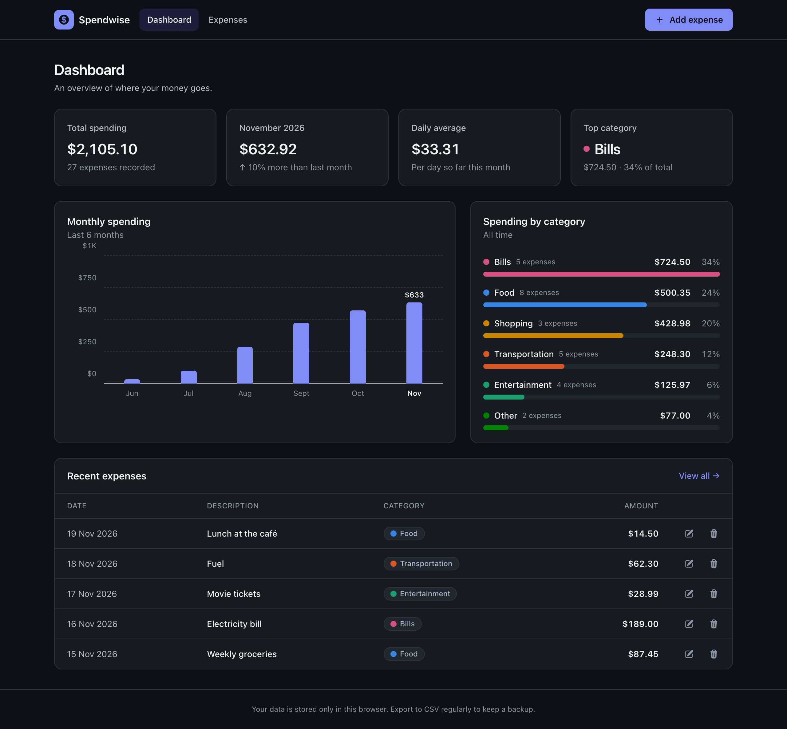
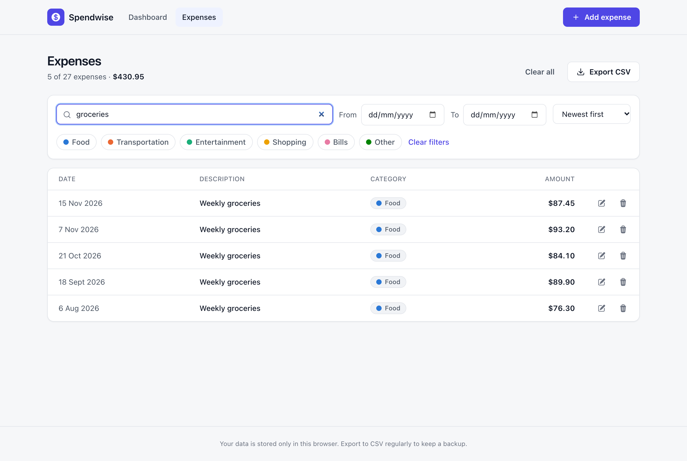
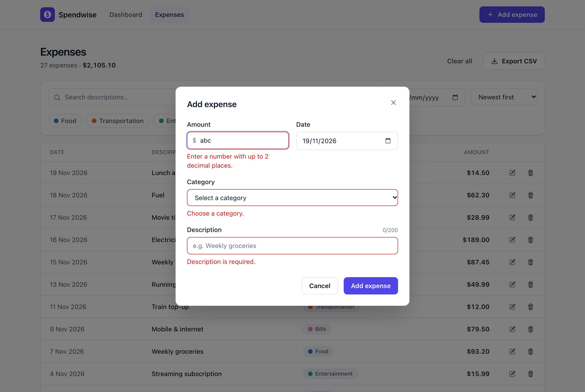
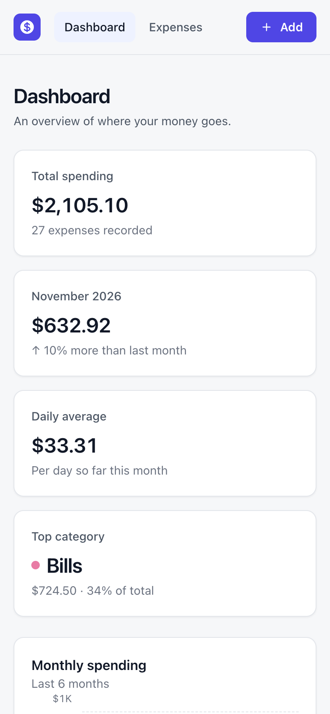
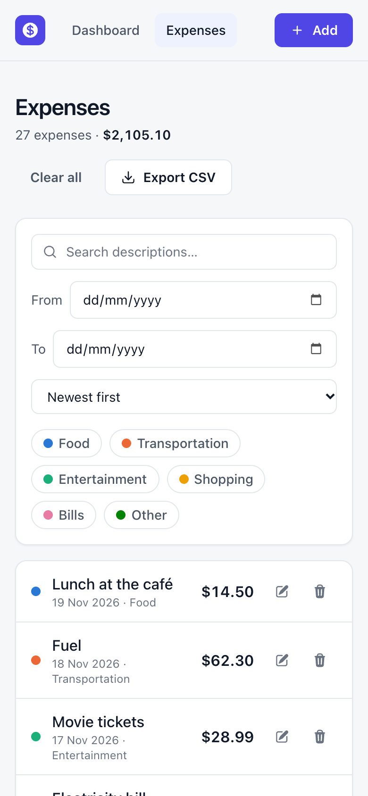

# Spendwise: Expense Tracker

[](https://github.com/Jermayy/expense-tracker-ai/actions/workflows/ci.yml)


A personal expense tracker built with Next.js 14 (App Router), TypeScript and Tailwind CSS.
Add, edit, filter and analyse your spending; export to CSV. All data stays in your browser (`localStorage`).

**[Live demo: spendwise-jermayy.vercel.app](https://spendwise-jermayy.vercel.app)**. Click
"Load sample data" to explore it with realistic expenses.

> **Learning exercise.** This project was built for **Claude Code: Software Engineering with
> Generative AI Agents**, a **Vanderbilt University** course on **Coursera**. The exercise: take a single, large,
> detailed prompt and have an AI coding agent turn it into a complete, production-ready
> application, not a throwaway demo. I'm using it to show my progress in agentic AI development.



## Screenshots

Captured from the production build (`npm run build`) using the app's built-in sample data.

| Dark mode (follows your OS setting)                            | Search and filters (kept in the URL)                                   |
| -------------------------------------------------------------- | ---------------------------------------------------------------------- |
|  |  |

| Inline form validation                                                                     | Mobile dashboard                                               | Mobile expense list                                              |
| ------------------------------------------------------------------------------------------ | -------------------------------------------------------------- | ---------------------------------------------------------------- |
|  |  |  |

## About the exercise

### The brief

One large prompt described the whole app: the stack (Next.js 14 App Router, TypeScript,
Tailwind, React hooks), the features (add/edit/delete expenses, search and filters, summary
cards, charts, CSV export), the design bar (responsive, loading and error states, visual
feedback) and the quality bar ("a complete, production-ready application"). The full prompt is
in [docs/prompt.md](docs/prompt.md). The agent used was
[Claude Code](https://claude.com/claude-code).

### How I approached it

A big prompt alone gets you a big pile of code. What made the result production-ready was the
context and guardrails I gave the agent alongside the prompt:

- **A personal engineering playbook.** Standards for architecture, security, data, front end,
  testing, accessibility and documentation, loaded into every session through `CLAUDE.md`.
  The agent had to follow it and justify any deviation in writing.
- **A project `CLAUDE.md`** ([CLAUDE.md](CLAUDE.md)) recording this project's stack, commands,
  conventions and accepted deviations, so later sessions start with the right context.
- **A definition of done.** Format, lint, type check, tests and build must all pass
  (`npm run check`) before work counts as finished, and the agent has to report what it
  verified and what it didn't.
- **Decisions written down.** Choices that are hard to reverse get an Architecture Decision
  Record instead of being buried in code.

### What "production-ready" meant here

| Area           | What's in the repo                                                                                                                                                                                                                                                                                                                                       |
| -------------- | -------------------------------------------------------------------------------------------------------------------------------------------------------------------------------------------------------------------------------------------------------------------------------------------------------------------------------------------------------- |
| Architecture   | Code organised by feature; a pure domain layer (`src/features/expenses/domain`) with no React; one provider is the only code that writes to storage                                                                                                                                                                                                      |
| Data integrity | Money stored as integer cents (never floats); calendar dates with no timezone shift; a versioned storage envelope validated on every load; corrupt data is never silently overwritten                                                                                                                                                                    |
| Security       | [ADR 0001](docs/adr/0001-nextjs-14-static-export-localstorage.md): `npm audit` flagged open advisories in Next 14, so the app ships as a static export with no server attack surface. [ADR 0002](docs/adr/0002-vercel-hosting-and-security-headers.md): CSP and security headers set in `vercel.json`. CSV export is protected against formula injection |
| Testing        | 86 tests across 12 files (Vitest + Testing Library): domain rules, filters, analytics, CSV, storage failures, provider behaviour, form validation and dialog focus. Deterministic: injected clock, IDs and storage, pinned timezone                                                                                                                      |
| Accessibility  | Semantic HTML, labelled fields, keyboard operable, managed modal focus, accessible undo toasts, OS light/dark theme                                                                                                                                                                                                                                      |
| UX states      | Loading, empty, error and success states on every view; undo on delete; multi-tab sync                                                                                                                                                                                                                                                                   |
| Delivery       | GitHub Actions on every push and PR: install from lockfile, format, lint, type check, tests, build, plus gitleaks secret scanning and a dependency audit. `main` is protected: changes land by pull request with green CI. Vercel deploys a preview for every PR and production on merge. Dependabot keeps dependencies and actions current              |
| Tooling        | TypeScript strict, ESLint, Prettier, pinned Node version (`.nvmrc`), one command for the full CI sequence                                                                                                                                                                                                                                                |

### What it shows about my progression

- **From prompting to directing.** The prompt says _what_ to build; the playbook and
  `CLAUDE.md` say _how_. Persistent, reusable context beats repeating instructions in each prompt.
- **Verification over trust.** Generated code isn't done until checks and tests pass. The agent
  is expected to prove its work, not assert it.
- **Judgement stays human.** When the brief (Next 14) conflicted with security (unpatched
  advisories), the trade-off was surfaced, decided and recorded in an ADR rather than ignored.
- **Honest gaps.** Known limits are written down instead of hidden (see below).

### Known gaps

- No error tracker configured yet.
- The CI dependency audit reports but doesn't block, because of the accepted Next 14 advisories (ADR 0001).
- The CSP allows inline scripts and styles, which a Next static export needs (ADR 0002).
- Branch protection is a GitHub setting, so it isn't versioned in the repo.
- Next 14 is end of life; upgrading to a supported major is the first follow-up (ADR 0001).
- Data is per browser and per device. There's no backend, sync or auth by design.

## Features

- **Add / edit / delete** expenses (date, amount, category, description), with inline validation and **undo** on delete
- **Dashboard**: total, this month (vs last month), daily average, top category, 6-month trend chart, category breakdown, recent expenses
- **Expenses list**: text search, date-range and multi-category filters, sorting. Filters are stored in the URL, so you can bookmark or refresh a filtered view
- **CSV export** of the current filtered view (Expenses page) or of everything ("Export Data" on the dashboard). Columns: Date, Category, Amount, Description. Excel-safe UTF-8, protected against formula injection
- Responsive layout (table on desktop, cards on mobile), light/dark theme from your OS setting, keyboard and screen-reader friendly
- Clear loading, empty and error states. If stored data is corrupt it's never silently overwritten: you can download a backup first
- Multi-tab sync: changes in one tab show up in the others

## Quick start

Requires Node 20+ (`.nvmrc`).

```bash
npm ci            # install from lockfile
npm run dev       # http://localhost:3000
```

No environment variables are needed (there's no backend), so there's no `.env.example`.

## Commands

| Command                           | What it does                                               |
| --------------------------------- | ---------------------------------------------------------- |
| `npm run dev`                     | Dev server with hot reload                                 |
| `npm test`                        | Unit + component tests (Vitest, jsdom)                     |
| `npm run lint`                    | ESLint                                                     |
| `npm run typecheck`               | TypeScript strict check                                    |
| `npm run format` / `format:check` | Prettier                                                   |
| `npm run build`                   | Static export to `out/`                                    |
| `npm start`                       | Serve the built `out/` folder locally                      |
| `npm run check`                   | The same checks CI runs: format, lint, types, tests, build |

## Structure

```
src/
  app/                       routes: / (dashboard), /expenses, layout, error + 404 pages
  components/                AppShell + ui/ primitives (Modal, Toast, ConfirmDialog, styles)
  features/expenses/
    domain/                  types, money (integer cents), dates, validation (pure, no React)
    lib/                     filters, analytics, CSV, localStorage repository, sample data
    state/                   ExpensesProvider: React context, persists before committing to state
    components/              form, dialog, list, filters bar, charts, summary cards, views
tests/                       Vitest tests
docs/adr/                    architecture decisions
docs/screenshots/            README images
.github/                     CI workflow and Dependabot config
```

## Design notes

- **Money** is stored as integer cents, parsed from text without floats. Currency is AUD (`domain/money.ts`).
- **Dates** are `YYYY-MM-DD` local calendar dates, so there are no timezone shifts.
- **Persistence** writes to storage first and only then updates the UI. If a write fails (e.g. quota), the UI keeps the previous state and shows an error.
- **Deployment**: static export (`output: "export"`), hosted on Vercel and connected to this repo. Pull requests get a preview deployment; merging to `main` deploys to production. Security headers live in `vercel.json`. Roll back by promoting a previous deployment (`vercel rollback`). See [ADR 0001](docs/adr/0001-nextjs-14-static-export-localstorage.md) for the static export and the Next 14 security note, and [ADR 0002](docs/adr/0002-vercel-hosting-and-security-headers.md) for hosting and headers.

## Privacy

Expenses never leave the browser: no analytics, no network calls. Clearing site data, private
windows, or Safari's 7-day storage eviction can delete them, so **export to CSV regularly**.
