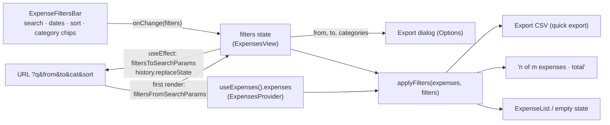

# Search, filters and sorting

> User guide: [Finding expenses: search, filters and sorting](../user-guide/filtering.md)

## Overview

The **Expenses** page can narrow the list by text search, an inclusive date range and one or more categories, and sort it by date or amount. The header count, total and quick CSV export all follow the filtered list. Filters are mirrored in the URL, so a filtered view survives a refresh and can be bookmarked.

**Type: Frontend.** It's pure client code: React state, a pure filter function and `window.history`. There is no server code (the app is a static export, [ADR 0001](../adr/0001-nextjs-14-static-export-localstorage.md)).

## Architecture



| File                                                                                                                     | Responsibility                                                                                                             |
| ------------------------------------------------------------------------------------------------------------------------ | -------------------------------------------------------------------------------------------------------------------------- |
| [`src/features/expenses/lib/filters.ts`](../../src/features/expenses/lib/filters.ts)                                     | Pure: filter type and defaults, sort options, URL parse and serialise, `applyFilters`. No React.                           |
| [`src/features/expenses/components/ExpenseFiltersBar.tsx`](../../src/features/expenses/components/ExpenseFiltersBar.tsx) | Controlled UI: search box, **From** and **To** dates, sort select, category chips, **Clear filters**, invalid-range alert. |
| [`src/features/expenses/components/ExpensesView.tsx`](../../src/features/expenses/components/ExpensesView.tsx)           | Owns the filter state, syncs it to the URL, applies it, and passes the result to the list, header and export.              |
| [`src/app/expenses/page.tsx`](../../src/app/expenses/page.tsx)                                                           | Wraps `ExpensesView` in `<Suspense>`, which `useSearchParams` needs in a statically exported page.                         |

## Technical specification

**Filter shape** (`ExpenseFilters`, [`filters.ts:13`](../../src/features/expenses/lib/filters.ts#L13)): `query`, `from`, `to` (strings), `categories` (`Category[]`), `sort` (`SortOption`). Defaults (`DEFAULT_FILTERS`): everything empty, sort `date-desc`.

**Matching** (`applyFilters`, [`filters.ts:72`](../../src/features/expenses/lib/filters.ts#L72)). An expense is kept when all of these hold:

| Filter     | Rule                                                                                                                                                                   |
| ---------- | ---------------------------------------------------------------------------------------------------------------------------------------------------------------------- |
| From       | `expense.date >= from` (inclusive). Compared as `YYYY-MM-DD` strings, so there's no timezone conversion.                                                               |
| To         | `expense.date <= to` (inclusive).                                                                                                                                      |
| Categories | Empty list means any category; otherwise the expense's category must be in the list (OR within categories).                                                            |
| Search     | The query is trimmed and lower-cased, then must be a substring of `` `${description} ${category}` `` lower-cased. So it matches category names too, and can span both. |

Empty `from`, `to` or query means no constraint. The input array is never mutated.

**Sorting** (`COMPARATORS`, [`filters.ts:65`](../../src/features/expenses/lib/filters.ts#L65)):

| Value         | UI label       | Order                    | Tie-break                  |
| ------------- | -------------- | ------------------------ | -------------------------- |
| `date-desc`   | Newest first   | `date` descending        | `createdAt` descending     |
| `date-asc`    | Oldest first   | `date` ascending         | `createdAt` ascending      |
| `amount-desc` | Highest amount | `amountCents` descending | `date` descending (newest) |
| `amount-asc`  | Lowest amount  | `amountCents` ascending  | `date` descending (newest) |

**Active filters** (`hasActiveFilters`): true when query, from, to or categories is set. Sort alone isn't a filter. It controls the header wording and whether **Clear filters** is shown.

**Clear filters** resets query, dates and categories but keeps the current sort ([`ExpenseFiltersBar.tsx:129`](../../src/features/expenses/components/ExpenseFiltersBar.tsx#L129)).

**Limits**: the search box has `maxLength={100}`, and the URL parser truncates `q` to 100 characters (`MAX_QUERY_LENGTH`).

## API and interfaces

### Exports of `lib/filters.ts`

| Export                              | Signature                                           | Notes                                                  |
| ----------------------------------- | --------------------------------------------------- | ------------------------------------------------------ |
| `SORT_OPTIONS`                      | `{ "date-desc": "Newest first", … } as const`       | Keys are the sort values, values are the UI labels.    |
| `SortOption`                        | `keyof typeof SORT_OPTIONS`                         |                                                        |
| `ExpenseFilters`, `DEFAULT_FILTERS` | interface and constant                              | See the specification above.                           |
| `applyFilters(expenses, filters)`   | `(readonly Expense[], ExpenseFilters) => Expense[]` | Returns a new, filtered and sorted array.              |
| `filtersFromSearchParams(params)`   | `(URLSearchParams) => ExpenseFilters`               | Treats the URL as untrusted; drops anything malformed. |
| `filtersToSearchParams(filters)`    | `(ExpenseFilters) => URLSearchParams`               | Omits defaults, so an unfiltered view has a clean URL. |
| `hasActiveFilters(filters)`         | `(ExpenseFilters) => boolean`                       |                                                        |

### `ExpenseFiltersBar` props

| Prop       | Type                                | Notes                                                       |
| ---------- | ----------------------------------- | ----------------------------------------------------------- |
| `filters`  | `ExpenseFilters`                    | Fully controlled; the bar holds no filter state of its own. |
| `onChange` | `(filters: ExpenseFilters) => void` | Called with the whole next filter object on every change.   |

### URL parameters (`/expenses/`)

| Param  | Value                                                                           | When invalid                                                       |
| ------ | ------------------------------------------------------------------------------- | ------------------------------------------------------------------ |
| `q`    | Search text (truncated to 100 characters)                                       | n/a                                                                |
| `from` | `YYYY-MM-DD`, must be a real calendar date (`isIsoDate`)                        | Dropped (`from=yesterday`, `2026-02-30`)                           |
| `to`   | Same as `from`                                                                  | Dropped                                                            |
| `cat`  | Comma-separated category names, e.g. `Food,Bills`                               | Unknown names and duplicates dropped; stored in `CATEGORIES` order |
| `sort` | `date-asc`, `amount-desc` or `amount-asc` (omitted for the default `date-desc`) | Falls back to `date-desc`                                          |

Example: `/expenses/?from=2026-09-01&to=2026-10-31&cat=Food%2CBills&sort=amount-desc`.

### Browser APIs

- `useSearchParams` (Next.js) gives the initial state ([`ExpensesView.tsx:26`](../../src/features/expenses/components/ExpensesView.tsx#L26)). When it changes later, the view adopts it only if it matches the live `window.location.search` and differs from the current filters ([`ExpensesView.tsx:29`](../../src/features/expenses/components/ExpensesView.tsx#L29)). That picks up real navigations to the page (such as the **Expenses** nav link while filtered) and ignores the router's late echoes of the view's own `replaceState` calls, which would otherwise undo keystrokes while typing.
- `window.history.replaceState` writes it back on every change ([`ExpensesView.tsx:38`](../../src/features/expenses/components/ExpensesView.tsx#L38)). It replaces rather than pushes, so filter changes don't add Back-button entries.
- Native `<input type="date">`: the **From** picker gets `max={to}` and **To** gets `min={from}`, so the picker discourages an inverted range. Typed values can still invert it (see edge cases).

## Data and state

- **Nothing is persisted to storage.** Filter state lives in `useState` in `ExpensesView` and in the URL query string. The expense data comes read-only from `useExpenses()`; this feature never writes to `expense-tracker:v1`.
- `filtered` and `filteredTotal` are `useMemo`s over `expenses` and `filters`, so edits, deletes and changes synced from another tab re-filter automatically.
- **Privacy:** the search text and filters are in the page address. They end up in browser history and bookmarks, and are sent to the host (Vercel) in the request line when the page is reloaded or opened from a bookmark. Search text may contain words from the user's expense descriptions.

## Implementation notes

- The URL is untrusted input, so it's validated with the same domain helpers as stored data (`isIsoDate`, `isCategory`) and normalised (canonical category order, no duplicates). This keeps URLs stable and stops a crafted link from producing invalid state.
- Matching is a linear scan on every keystroke, without debouncing. That's fine for data held in `localStorage` (a few thousand records at most); add a debounce or index if that ever changes.
- `applyFilters` is shared: the dashboard's **Recent expenses** uses it with `DEFAULT_FILTERS`, and the export dialog's `selectExportRecords` reuses it for its own date and category selection.
- Category chips are `<button aria-pressed>` in a `role="group"` labelled "Filter by category". The search box and sort select have visually hidden labels. The header count is `aria-live="polite"`, so screen readers hear the new count, and the invalid-range message uses `role="alert"`.
- Chip colours come from the fixed category slot (`CategoryDot`), never from rank, per the project convention.

## Configuration

None. The sort options and the 100-character query limit are constants in `filters.ts`.

## Edge cases and errors

| Case                                            | What the user sees                                                                                                                                          |
| ----------------------------------------------- | ----------------------------------------------------------------------------------------------------------------------------------------------------------- |
| No expenses at all                              | The filter bar is hidden; the empty state "No expenses yet" with **Add expense**.                                                                           |
| Filters match nothing                           | "No matching expenses. Try a different search term, date range or category." Header shows "0 of N expenses · $0.00", and **Export CSV** is disabled.        |
| **From** after **To**                           | Both date fields are outlined red (`aria-invalid`) with the alert "“From” date is after “To” date — no expenses can match." The range isn't auto-corrected. |
| Loading / storage unreadable                    | The header without a count, plus the loading skeleton or the load-error view (from `StatusViews`).                                                          |
| Clicking **Expenses** in the nav while filtered | The filters reset and the full list shows, matching the new URL.                                                                                            |
| Malformed or hand-edited URL                    | Bad values are dropped silently and the URL is rewritten to the cleaned form (checked in a browser with `?cat=Food,Nope&from=yesterday&sort=random`).       |
| Expense edited so it no longer matches          | It disappears from the filtered list immediately.                                                                                                           |

### Known gaps

- **Back button:** because of `replaceState`, Back leaves the page instead of undoing the last filter change.
- **Whitespace-only search** counts as an active filter (the header shows "27 of 27 expenses" and **Clear filters** appears) even though it matches everything, because only matching trims the query.
- The search placeholder says "Search descriptions…", but it also matches category names.
- **No component tests** for `ExpenseFiltersBar` itself; its behaviour is covered only through the pure functions.

## Testing

| File                                                               | Covers                                                                                                                                                                            |
| ------------------------------------------------------------------ | --------------------------------------------------------------------------------------------------------------------------------------------------------------------------------- |
| [`tests/filters.test.ts`](../../tests/filters.test.ts)             | `applyFilters` (default sort, inclusive range, categories, case-insensitive search, amount sort, no mutation) and the URL round trip, defaults omitted, malformed values dropped. |
| [`tests/ExpensesView.test.tsx`](../../tests/ExpensesView.test.tsx) | URL sync in `ExpensesView`: reading filters from the URL, resetting them on navigation to the unfiltered page, and ignoring stale router updates while typing.                    |
| [`tests/exportOptions.test.ts`](../../tests/exportOptions.test.ts) | `selectExportRecords`, which reuses `applyFilters`.                                                                                                                               |

```bash
npx vitest run tests/filters.test.ts tests/ExpensesView.test.tsx tests/exportOptions.test.ts
```

Not covered by tests: the filter bar UI, **Clear filters** keeping the sort, the invalid-range alert, and the gaps above.

## Extending it

- **New filter** (for example an amount range): add the field to `ExpenseFilters` and `DEFAULT_FILTERS`, the rule to `applyFilters`, the param to both URL functions (validate it in `filtersFromSearchParams`), the condition to `hasActiveFilters`, and the control to `ExpenseFiltersBar`. Decide whether it should also be passed to `openExport` in `ExpensesView`. Add cases to `tests/filters.test.ts`.
- **New sort**: add a key and label to `SORT_OPTIONS` and a comparator to `COMPARATORS` (TypeScript enforces the second). The select and URL validation pick it up automatically.
- **New category**: it comes from `CATEGORIES` in `domain/types.ts`; chips, URL parsing and colours follow from that.

## Related features

- **Export** ([`src/features/expenses/export/`](../../src/features/expenses/export/), [`useCsvExport.ts`](../../src/features/expenses/components/useCsvExport.ts)): **Export CSV** downloads exactly the filtered, sorted list. **Options** opens the export dialog pre-filled with the current **From**, **To** and categories; the search text isn't carried over because the dialog has no search. An empty category filter becomes "all ticked" in the dialog (`defaultExportOptions`). The dialog's own selection reuses `applyFilters` (`selectExportRecords`).
- **Backup reminders** ([`lib/backupReminder.ts`](../../src/features/expenses/lib/backupReminder.ts)): a quick CSV export counts as a backup only when the filtered list contains every expense, so exporting a filtered view doesn't reset the reminder.
- **Dashboard** ([`DashboardView.tsx`](../../src/features/expenses/components/DashboardView.tsx)): **Recent expenses** uses `applyFilters` with the default sort, and **View all →** opens the unfiltered Expenses page.
- **Expense list** ([`ExpenseList.tsx`](../../src/features/expenses/components/ExpenseList.tsx)): renders the filtered result as a table on desktop and cards on small screens.
