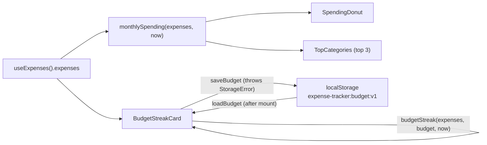

# Monthly Insights

> User guide: [Monthly Insights: this month at a glance](../user-guide/monthly-insights.md)

## Overview

The **Insights** page (`/insights/`) shows the current calendar month at a glance, following the original napkin sketch: a donut of spending by category with "Spending" and the month total in the centre, the top three categories (emoji, name, amount, colour bar), and a **Budget streak** card.

The streak counts consecutive days, ending today, on which the user spent at or under a daily allowance taken from a **monthly budget they set**. The budget is the only new stored data.

**Type: Frontend.** Pure client code. There's no server (static export, [ADR 0001](../adr/0001-nextjs-14-static-export-localstorage.md)).

## Architecture

| File                                                                                                                   | Responsibility                                                                                       |
| ---------------------------------------------------------------------------------------------------------------------- | ---------------------------------------------------------------------------------------------------- |
| [`src/features/expenses/lib/insights.ts`](../../src/features/expenses/lib/insights.ts)                                 | Pure: `monthlySpending`, `budgetStreak`, `dailyAllowanceCents`, `daysInMonth`. No React.             |
| [`src/features/expenses/lib/budget.ts`](../../src/features/expenses/lib/budget.ts)                                     | Budget storage: `parseBudget`, `loadBudget`, `saveBudget`, `isValidBudgetCents`.                     |
| [`src/features/expenses/components/MonthlyInsights.tsx`](../../src/features/expenses/components/MonthlyInsights.tsx)   | The screen: loading, load-error, no-expenses and no-spending-this-month states; donut; top 3 list.   |
| [`src/features/expenses/components/SpendingDonut.tsx`](../../src/features/expenses/components/SpendingDonut.tsx)       | SVG donut (one stroked circle per segment). One `role="img"` with a full text breakdown as its name. |
| [`src/features/expenses/components/BudgetStreakCard.tsx`](../../src/features/expenses/components/BudgetStreakCard.tsx) | Budget form (set and edit), streak number, allowance, this month's spend against the budget.         |
| [`src/app/insights/page.tsx`](../../src/app/insights/page.tsx)                                                         | Route and page title.                                                                                |

## Technical specification

**Month.** The calendar month containing `now` (local time). Expenses dated in other months are ignored for the donut and the top 3.

**Ranking.** By total descending. Ties keep the fixed `CATEGORIES` order (stable sort). Colours come from the category's fixed slot (`categoryColor`), never from rank.

**Budget storage.** Key `expense-tracker:budget:v1`, value `{ "version": 1, "monthlyBudgetCents": <int> }`. The amount must be a safe integer, `> 0` and `≤ MAX_AMOUNT_CENTS`. If the stored value is missing, malformed or the wrong version, it's treated as "not set" with a `console.warn`. This is a setting the user can re-enter, not expense data, so the next save overwrites it. `saveBudget` throws `StorageError`, and the form shows the message inline.

**Daily allowance.** `monthlyBudgetCents ÷ days in that day's month`. The UI shows it floored to cents. The streak compares exactly in integers (`spent × daysInMonth > budget` means over), so no rounding is involved.

**Streak** (`budgetStreak`). Walk back from today, one local calendar day at a time:

- A day counts if its total is at or under that day's allowance. Days with no expenses count.
- Today counts as "so far". If today is already over, the streak is 0.
- Stop at the first day over the allowance, or before the earliest expense, because there's no record of earlier days.
- Stop after `MAX_STREAK_DAYS` (3,660, about ten years) in any case, so a typo'd date like `0999-…` can't make the walk huge.
- Future-dated expenses are ignored. The donut, top 3 and "X of budget" bar do include future-dated expenses in the current month, the same as the Dashboard's "This month" card.
- Days are built from calendar parts, so daylight-saving changes don't skip or repeat a day.

**Progress bar.** This month's total as a share of the budget, capped at 100%. When over budget it turns red and shows "Over this month's budget." as text, so colour isn't the only cue.

**Accessibility.**

- The donut is a single image whose accessible name lists every category with its amount and share. The centre label and the visible legend (every segment, so colour is never the only cue) are `aria-hidden` because the name already covers them.
- The streak number and its unit are one paragraph, so they're read together ("12 days!").
- The month subtitle isn't rendered while loading, which is the state that gets prerendered, so the static HTML doesn't contain the build month.
- Emoji are `aria-hidden`.
- The top 3 is an ordered list.
- The budget input is labelled. Errors use `role="alert"` with `aria-invalid` and `aria-describedby`.
- Editing moves focus to the input. Saving or cancelling returns focus to **Edit budget**.

**Testing.** [`tests/insights.test.ts`](../../tests/insights.test.ts) covers the pure logic and storage: ties, month boundaries, exact-allowance days, DST, future dates and storage failure. [`tests/MonthlyInsights.test.tsx`](../../tests/MonthlyInsights.test.tsx) covers the screen states, budget validation, saving, editing and focus. The view takes an optional `now` prop for deterministic tests.

## Limitations and possible changes

- Only the current month is shown. There's no month picker.
- One budget for the whole month. There are no per-category budgets.
- The budget is per browser and isn't included in exports or the full backup, so restoring a backup on a new browser means setting it again.
- `now` is fixed when the page mounts. A tab left open past midnight shows yesterday's streak until it's reloaded (the Dashboard behaves the same).
