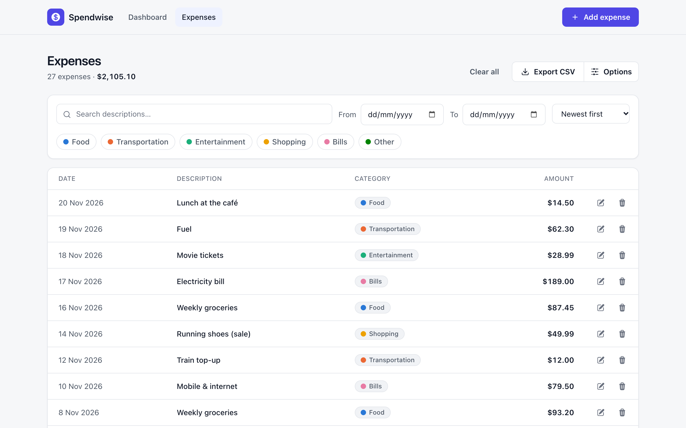
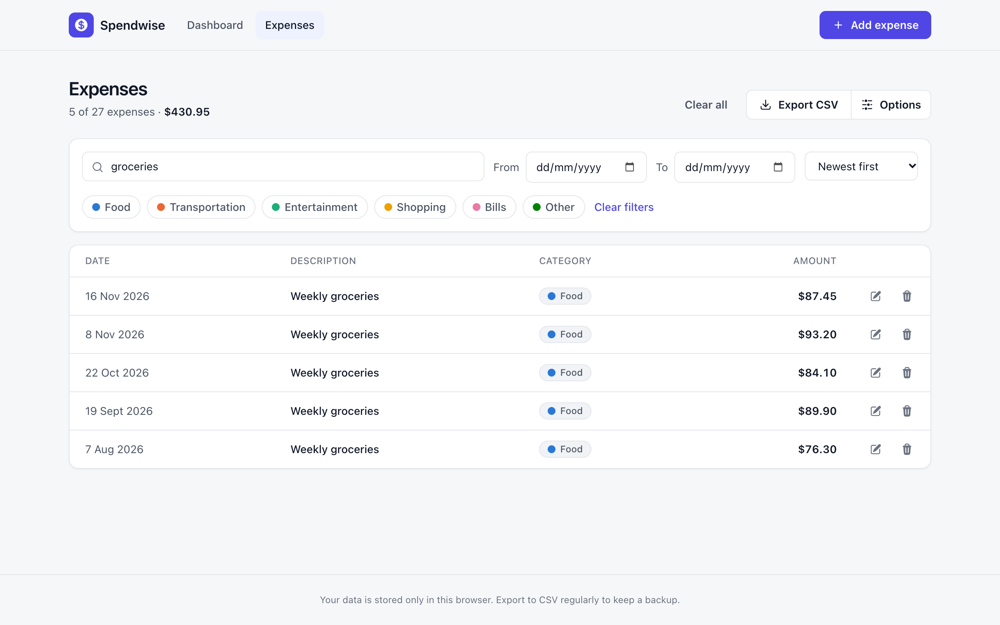
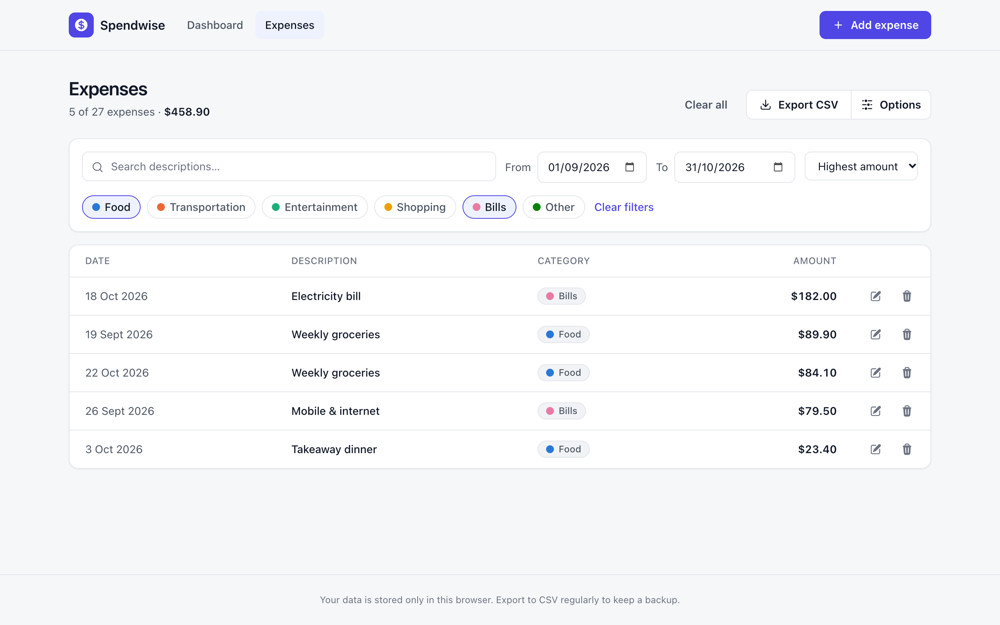
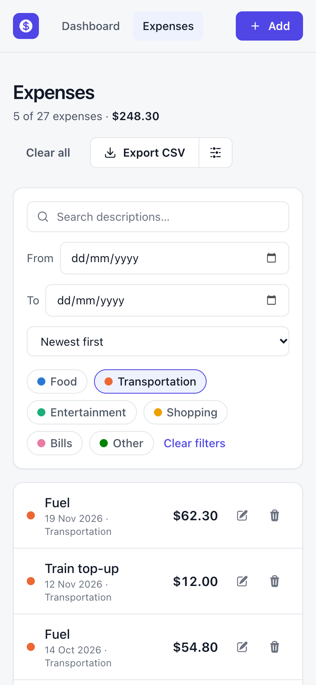
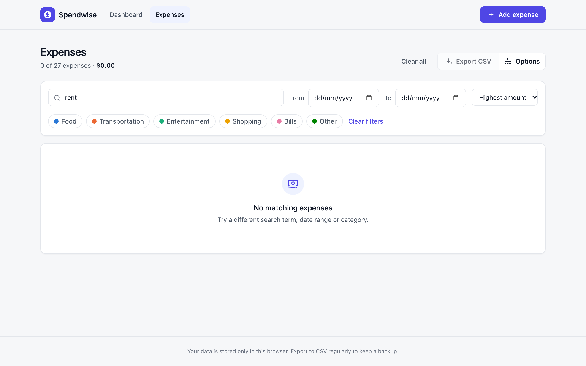
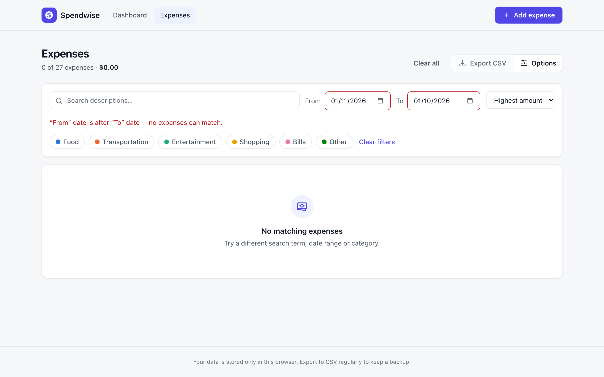

# Finding expenses: search, filters and sorting

> Technical details: [Search, filters and sorting developer documentation](../features/filtering.md)

## What it's for

Find the expenses you're looking for, such as all your groceries or everything you spent on bills last quarter, and see their total straight away. You can also put the list in the order you want.

## Before you start

You need at least one expense. The search and filter controls only appear once you have some. To try it out, click **Load sample data** on the **Dashboard**.

## Step by step

### Open the expense list

1. Click **Expenses** in the top bar (or **View all →** under **Recent expenses** on the **Dashboard**).
2. The filter panel is at the top, above your list. The line under the **Expenses** heading shows how many expenses you have and their total.

<!-- screenshot: filters-bar | route: /expenses/ | state: sample data loaded, no filters | viewport: desktop | theme: light -->

### Search

1. Type in the box that says **Search descriptions…**. The list updates as you type.
2. The line under the heading changes to show how many expenses match, for example "5 of 27 expenses", with the total of just those.

Search ignores capital letters, and it also matches category names, so typing "bills" finds everything in **Bills**.

<!-- screenshot: search | route: /expenses/ | state: sample data loaded, search "groceries" | viewport: desktop | theme: light -->

### Filter by category and date

1. Click one or more category buttons (**Food**, **Transportation**, **Entertainment**, **Shopping**, **Bills**, **Other**). A selected button is highlighted. Click it again to remove it. With several selected, you see expenses from any of them.
2. To limit the dates, pick a **From** date, a **To** date, or both. Both dates are included.
3. Filters work together. For example, **Food** and **Bills** from 1 September to 31 October shows only food and bill expenses in those two months.

<!-- screenshot: categories-and-dates | route: /expenses/ | state: sample data loaded, Food and Bills selected, From 2026-09-01, To 2026-10-31, sort Highest amount | viewport: desktop | theme: light -->

### Sort the list

Use the menu on the right of the filter panel to choose **Newest first** (the default), **Oldest first**, **Highest amount** or **Lowest amount**.

### Clear your filters

Click **Clear filters** next to the category buttons. It removes the search, dates and categories but keeps your sort order. It only appears when a filter is on.

### On a phone

The controls stack one above the other, and the list shows as cards instead of a table. Everything else works the same way.

<!-- screenshot: mobile | route: /expenses/ | state: sample data loaded, Transportation selected | viewport: mobile | theme: light -->

## Options explained

| Option                   | What it does                                                     | When to use it                                 |
| ------------------------ | ---------------------------------------------------------------- | ---------------------------------------------- |
| **Search descriptions…** | Shows expenses whose description or category contains your text. | You remember a word, like "fuel" or "gift".    |
| **From** / **To**        | Shows expenses on or after **From** and on or before **To**.     | A month, a quarter or a financial year.        |
| Category buttons         | Shows expenses in any of the selected categories.                | Seeing what one kind of spending adds up to.   |
| Sort menu                | Orders the list by date or amount.                               | **Highest amount** to find your biggest costs. |
| **Clear filters**        | Removes search, dates and categories (keeps the sort).           | Getting back to the full list.                 |

## What you'll see if something goes wrong

**"No matching expenses"**: nothing matches your filters. The heading shows "0 of …" and **Export CSV** is greyed out. Try a shorter search word, a wider date range, or click **Clear filters**.

<!-- screenshot: no-matches | route: /expenses/ | state: sample data loaded, search "rent" | viewport: desktop | theme: light -->

**"“From” date is after “To” date — no expenses can match."**: the start date is later than the end date, so both date fields turn red. Change one of the dates.

<!-- screenshot: invalid-range | route: /expenses/ | state: sample data loaded, From 2026-11-01, To 2026-10-01 | viewport: desktop | theme: light -->

**No filter panel at all**: you don't have any expenses yet. Add one with **Add expense**, or load the sample data from the **Dashboard**.

**The page is still loading, or shows an error about your saved data**: filtering waits until your data has loaded. If your saved data can't be read, follow the steps on that screen. The app won't delete it without asking you.

## Tips and FAQs

**Does refreshing the page lose my filters?** No. Your filters are saved in the page address, so a refresh keeps them, and you can bookmark a filtered view to come back to it.

**How do I get back to the full list quickly?** Click **Clear filters**, or click **Expenses** in the top bar. The **Expenses** link also resets your sort order to **Newest first**.

**Does the Back button undo a filter?** No. Back takes you to the previous page, not the previous filter.

**Can I export just what I've filtered?** Yes. **Export CSV** downloads exactly the expenses on screen, in the order shown. **Options** opens the export dialog with your dates and categories already chosen (but not your search text). See [Related features](#related-features).

**Is my search private?** Your expenses never leave your browser. But your search words and filters are part of the page address, so they're kept in your browser history and bookmarks, and are sent to the website's host if you reload the page or open a bookmark. Avoid searching for anything you wouldn't want in your history.

**Is there a limit on search length?** Yes, 100 characters.

## Related features

- **Export** ([overview in the README](../../README.md#features)): **Export CSV** saves the filtered list, and **Options** starts from your current dates and categories.
- **Backup reminders** ([overview in the README](../../README.md#features)): only an export of _all_ your expenses counts as a backup. Exporting a filtered list won't stop the reminder on the **Dashboard**.
- **Dashboard**: **Recent expenses** always shows your newest expenses, unfiltered. Click **View all →** to come to this page.
